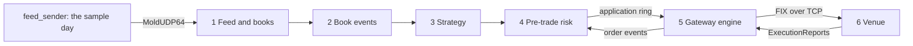

# 001 — Scope and plan

**Status:** Agreed · **Updated:** 2026-10-31

## Proposal

The path from market data to an order on the wire, built from the three repos before it: ITCH in
(`itch-feed-handler`), a queue (`lockfree-ipc`), pre-trade risk, FIX out (`fix-order-gateway`).
A packet of the day's feed arrives, the book changes, a deliberately simple strategy decides to
send or move an order, the risk checks pass or refuse it, and the gateway journals it and writes
a NewOrderSingle to the venue. Its time from the triggering packet to the order leaving is
measured as the others are: percentiles, open loop, with the machine's conditions in every run.

It is meant to be judged on four things:

1. **Tick to trade, measured honestly.** From the triggering ITCH message's intended send time to
   the order's arrival at the venue, over loopback and over the card, split into stages, beside
   the components' own published figures, so the cost of joining them is visible.
2. **Pre-trade risk from the public rules.** The controls EU RTS 6 Article 15 requires of an
   investment firm on order entry, and the open-order exposure SEC Rule 15c3-5 requires, each
   tested by orders built to break it; every order the venue receives passed every check.
3. **Safe when the inputs are not.** No order on a book the feed marks unreliable, none while the
   gateway is not logged on, and a kill switch that stops new orders and cancels the open ones.
4. **Alternatives, measured.** How the work is arranged on threads and processes, and what the
   gateway's durability costs in the tick-to-trade figure.

**Where the risk is.** The costly failure is an order that should not have gone: on a book that
was stale, past a limit that was miscounted, or after the kill switch. So every refusal path is a
test, and the risk state counts each order as it is sent (RTS 6 Art. 15(2)), not as it is filled.

It does:

- consume book updates from the feed handler and orders through the gateway's engine, unchanged
  where possible, each fetched at a pinned commit;
- a strategy simple enough to be obviously not a trading idea (D2), there to make orders happen
  at the market's pace;
- pre-trade risk: the checks of D3, a reference implementation for correctness and as a baseline,
  limits from a configuration file, every refusal counted by reason;
- a kill switch, and the strategy and risk state reported in a monitoring block;
- one program that runs it all, and the benchmarks.

It does not:

- trade, or contain a trading idea: the strategy is a fixed rule, published, nothing tuned;
- simulate an exchange matching against the feed: the venue is the gateway's simulator, with a
  book of its own (D5);
- keep positions across days, margin, or post-trade risk (P&L limits, reconciliation);
- connect to a real venue or feed: the feed is our sender replaying the sample day, the venue our
  simulator, both on this machine;
- use kernel bypass or FPGAs: the kernel paths of the two repos before it are measured and their
  floors stated.

## Design

**Sources**, all public:

- *Commission Delegated Regulation (EU) 2017/589* (RTS 6), Article 15, "Pre-trade controls on
  order entry": price collars, maximum order values, maximum order volumes and maximum messages
  limits (15(1)); each order counted against the limits as it is sent (15(2)); execution
  throttles (15(3)); market and credit risk limits (15(4)); orders blocked for an instrument the
  trader may not trade or past the firm's risk thresholds (15(5)). In the UK the onshored text is
  still the standard the FCA reviews against (its multi-firm review of algorithmic trading
  controls, August 2025), and is listed for revocation under the Financial Services and Markets
  Act 2023; what replaces it is not checked here;
- *SEC Rule 15c3-5* (the Market Access Rule): credit and capital thresholds checked before entry,
  exposure measured on orders entered, open orders included, and erroneous orders refused by
  price or size;
- *FIA, Best Practices for Automated Trading Risk Controls and System Safeguards*, July 2024: for
  context (local pre-trade controls, not credit controls, as the main guard against errors);
- the three repos' own design notes.

**The components:**

| # | Component | From |
|---|---|---|
| 1 | Feed, sequencing, decoding, books | `itch-feed-handler` (receiver, sequencer, decoder, handler, books, recovery) |
| 2 | Book events to the strategy | New: a handler sink giving the strategy each book change of its instruments, with the feed's reliability |
| 3 | Strategy | New: D2's rule |
| 4 | Pre-trade risk | New: D3's checks, a reference implementation, limits from configuration, the kill switch |
| 5 | Order entry | `fix-order-gateway` (engine, session, journal, order state machine): orders in through its application ring, order events back |
| 6 | Venue | `fix-order-gateway`'s `order_venue`, in its own process |
| 7 | Queues | `lockfree-ipc`'s rings between threads, or the feed handler's publisher between processes (D4) |
| 8 | Measurement | `lockfree-ipc`'s harness; the feed handler's sender stamps; a stamp at the venue on the same clock |

**What a clock can see.** The feed handler's sender writes each message's intended send time to
shared memory (its note 010); the venue reads the NewOrderSingle and stamps it, on the same
machine and the same `CLOCK_MONOTONIC` (the network namespaces share it). So tick to trade is
intended send of the triggering message to the venue's read: both kernels' paths and every stage
between, and nothing left out by where the clock starts. Stamps inside the program split it:
datagram read, book changed, decision, risk passed, written to the socket.

**What the parts already cost** (their published figures, p50): the feed handler, packet to
published update ~11.3 µs over loopback at 10k packets a second (with recording; ~43 messages a
packet, the wait inside a packet included); the gateway, order to ExecutionReport round trip
19.0–20.6 µs with journal C (survives a process crash) and 115–257 µs with journal A (survives
power loss, an `fdatasync` an order). So the gateway's durability choice, not the queue or the
risk checks, is expected to set the figure (D6).

**Decisions** (each with what is proposed):

- **D1. The repo's name.** *Proposed (A):* `tick-to-trade`: what it measures. *Alternative (B):*
  `trading-path` or another name of Shep's.
- **D2. The strategy.** *Proposed (A):* quote following on a configured list of instruments: on
  a change of an instrument's best bid, a buy limit order for one round lot at the new best bid
  (new, or a cancel/replace of the resting one); nothing else. The real market sets the pace and
  its bursts, and the list sets the order rate. *Alternative (B):* a synthetic trigger (an order
  every Nth update): any rate on demand, but not the market's own.
- **D3. The risk checks.** *Proposed (A):* RTS 6 Article 15's four on order entry (a price collar
  against the feed's best price, refused when the instrument's book is unreliable; maximum order
  value; maximum order volume; a maximum messages limit a second), its execution throttle, an
  instrument permission list, and 15c3-5's credit limit on exposure from open orders and fills,
  each counted at send; the kill switch. *Alternative (B):* the four entry checks only.
- **D4. Threads and processes.** *Proposed (A):* the default in one process: the feed thread
  hands book events through an SPSC ring to the strategy and risk thread, which submits through
  the gateway's application ring to its engine thread. Measured beside it: (B) feed, strategy and
  risk on one thread, no queue; (C) the strategy and risk as a consumer process of the feed
  handler's publisher, the program `itchfh` unchanged. *Alternative:* A alone.
- **D5. The venue.** *Proposed (A):* the gateway's `order_venue`, unchanged but for the stamp:
  its own book, so passive orders at the best bid rest and are acknowledged. *Alternative (B):* a
  venue that fills against the feed's book: closer to a market, but an exchange simulator, out of
  scope.
- **D6. Durability.** *Proposed (A):* published with journal C (a process crash) as the headline
  and journal A (power loss) beside it, the guarantee in every row, as the gateway does.
  *Alternative (B):* journal A only.
- **D7. Paces and paths.** *Proposed (A):* the feed at fixed paces (10k, 25k, 50k packets a
  second) and at the day's own pace over the open (09:29:30 for five minutes), as the feed
  handler's note 010; over loopback and over the card, the sender and the venue both in the
  card's far namespace. *Alternative (B):* loopback only.

**Building on the three repos.** Each fetched by CMake at a pinned commit into `build/`. The
gateway and the feed handler both fetch `lockfree-ipc`, at present the same commit (`c733131`);
this repo pins one and checks the others agree, so there is one queue and one harness.

**Component notes, in order** (each a Draft for agreement before code):

| Note | Component | The hard part |
|---|---|---|
| 002 | Book events and the strategy (2, 3) | A sink beside the publisher without slowing the handler; the reliability carried with every event; D2's rule, deterministic over a recorded day |
| 003 | Pre-trade risk (4) | D3's checks counted at send; exposure from open orders and fills as ExecutionReports return; the reference implementation; every refusal path tested |
| 004 | The program (1, 5, 7) | D4's arrangements; the feed's reliability and the gateway's session state gating orders; the kill switch; configuration and monitoring |
| 005 | Measurement (6, 8) | The venue's stamp; tick to trade and its stages; D6's durability, D7's paces and paths |

## Spec

The repo as a whole, checked as the notes reach Measured:

- S1. Every order the venue receives passed every check of D3; each check refuses the orders
  built to break it, counted by reason, and the limits count each order as it is sent.
- S2. No new order is sent for an instrument whose book is marked unreliable, or while the
  gateway is not logged on; after the kill switch, no new order is sent and every open order is
  cancelled.
- S3. The strategy and the risk checks give the same orders (instrument, side, price, quantity, in
  the same order) for the same inputs in the same order. Two runs of the program are compared and
  their agreement published, not required: against a live venue, when an answer arrives relative
  to the book events decides what is sent next (amended by note 004, D7).
- S4. The feed-to-order hot path makes no allocation in steady state and no system call but the
  socket reads and writes it is meant to make (the compiled call graph checked, as the repos
  before it).
- S5. Tick to trade, and its stages, published as percentiles over at least three runs per path,
  arrangement and durability, via `run.py report`, beside the components' own figures.
- S6. Each measured alternative (D4's arrangements, D6's durability) is published beside the
  others; the default is justified from them.

## Tasks

- [x] Shep: empty GitHub repo (private), named per D1
- [ ] Notes 002–005, one at a time, each agreed before its code

## Review

| Date | Stage | Finding |
|---|---|---|
| 2026-10-30 | Draft | Written for review from the record (no overview exists for this repo). Checked while writing: RTS 6 Art. 15's text (legislation.gov.uk), its UK status (FCA review, August 2025; listed for revocation under FSMA 2023), Rule 15c3-5's adopting release, FIA's July 2024 paper; the feed handler's consumer and handler sink, the gateway's application rings and `order_venue`; both repos pin `lockfree-ipc` at `c733131` |
| 2026-10-30 | Agreed | Approved by Shep, every decision as proposed (option A each): D1 `tick-to-trade`; D2 quote following on a configured list; D3 RTS 6 Art. 15's entry checks and throttle, a permission list, 15c3-5's credit limit on open orders and fills, the kill switch; D4 one process, three threads, with one thread and a publisher consumer process measured beside it; D5 `order_venue` with a stamp; D6 journal C the headline, A beside; D7 fixed paces and the open, loopback and the card |
| 2026-10-31 | Agreed (amended) | S3 amended by note 004's D7 (agreed by Shep): the program's orders depend on when the venue's answers arrive relative to the book events (one request in flight an instrument), so two runs are compared and their agreement published; determinism is required of the strategy and the risk for the same inputs in the same order, shown by notes 002 and 003's day tests |
