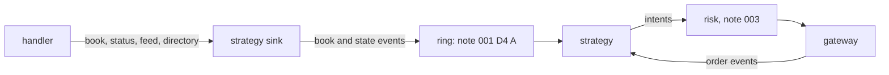

# 002 — Book events and the strategy

**Status:** Measured · **Updated:** 2026-10-31

## Proposal

Components 2 and 3 of note 001: what the strategy is told about the market, and what it does
with it. The feed handler's handler reports every change to a sink it is given as a template
argument (its note 003); the publisher is one such sink. This note adds a second: it watches the
instruments the strategy trades and hands the strategy each change of their best prices, with
whether the book can be trusted. The strategy is note 001's D2: quote following, one buy order
per instrument resting at the best bid, moved when the bid moves, cancelled when the book cannot
be trusted.

It does:

- a sink for the feed handler's handler, giving a **book event** for each change of a traded
  instrument's best bid or ask, and a **state event** when the feed's state, an instrument's
  soundness or its trading state changes;
- the same events from the feed handler's publisher, for note 001's arrangement C (a consumer
  process), so the strategy cannot tell the two apart;
- the strategy: order **intents** (new, replace, cancel) out, the gateway's order events
  (acknowledged, replaced, cancelled, rejected, filled) in;
- a tool that ranks instruments by best-bid changes over the sample day, to choose the lists the
  benchmarks trade.

It does not:

- check risk (note 003) or send anything (note 004): intents go to the risk checks;
- trade on anything but the best bid: no signal, no sizing, nothing tuned (note 001);
- touch the feed handler's code: the sink is a type of this repo, given to its handler.

## Design

**A book event is a state, not a change.** Each carries the instrument's whole top of book after
the change (best bid and ask, price and shares), the ITCH sequence number and timestamp of the
message that caused it, and the instrument's reliability. So a later event replaces an earlier
one entirely: if events must be dropped, only the newest per instrument matters (D4).

**Which instruments.** The configuration names them by symbol; the sink learns each one's Stock
Locate from the day's Stock Directory messages (the handler's `directory` call) and ignores every
other locate with one table lookup.

**The strategy, per instrument:** at most one order, and at most one request in flight for it.

| State | On a usable event with a new best bid | On an unusable event | On an order event |
|---|---|---|---|
| no order | new: buy one round lot at the bid | nothing | — |
| resting | replace to the new bid | cancel | filled: back to no order; cancelled: no order |
| request in flight | remember the newest bid | remember to cancel | its answer settles the state; then act on what was remembered |

An event is usable when the feed is `live`, the instrument's book is sound and its trading state
is `T` (trading). A round lot is the directory's Round Lot Size for the instrument. Prices come
from the book unchanged; the risk checks (note 003) decide whether they are acceptable.

**Determinism.** The sink and the strategy read no clock and keep no state but what events and
order events give them, so a recorded day gives the same intents whenever it is replayed, with
the venue's answers in the same order (note 001's S3). Client order IDs come from a counter
started at a configured value.

**Decisions** (each with what is proposed):

- **D1. The trigger.** *Proposed (A):* a change of the best bid's price; a change only of its
  shares, or of the ask, sends no intent (the ask is carried for the risk checks' collar).
  *Alternative (B):* any change of the top of book: several times the intents for the same
  instruments.
- **D2. Moving an order.** *Proposed (A):* OrderCancelReplaceRequest (one message, the order keeps
  its place in the gateway's order state machine). *Alternative (B):* cancel, then a new order
  once the cancel is acknowledged: two messages and a round trip without an order.
- **D3. The sink in the handler.** *Proposed (A):* a sink of this repo given to the handler in
  place of the publisher (arrangements A and B of note 001's D4), and an adapter turning the
  publisher's level updates into the same events (arrangement C). *Alternative (B):* a sink that
  forwards every call to the publisher as well: the program could publish to other consumers at
  once, at the publisher's cost on the feed thread.
- **D4. A full ring (arrangement A).** *Proposed (A):* the feed thread never waits: if the ring to
  the strategy is full, it keeps the newest event of each instrument aside, pushes them when
  there is room, and counts each event replaced (the feed handler lost the feed when its
  receiving thread waited on a full ring: its note 007). *Alternative (B):* the feed thread
  waits: simpler, and the feed is lost under a slow strategy.
- **D5. The instrument lists for the benchmarks.** *Proposed (A):* from the tool's ranking over
  the sample day, the 1, 10 and 100 instruments with the most best-bid changes over the open
  (09:29:30 for five minutes), so the order rate rises by list, recorded in each run.
  *Alternative (B):* a list chosen by hand.

## Spec

- S1. Over the sample day, the book events for a list of instruments equal those derived from the
  feed handler's reference book after every message (best bid and ask, sequence, reliability),
  through the sink and through the publisher's adapter alike.
- S2. The strategy follows the table above: tested state by state with built events and order
  events, and over the sample day against a reference strategy written for clarity on the
  reference book; the intents are equal.
- S3. No new or replace intent from an unusable event; an unusable event cancels the resting
  order (or the request in flight, once answered).
- S4. With a full ring the feed thread never waits; the strategy's last event for each instrument
  is the newest, and each replaced event is counted.
- S5. The sink, the adapter and the strategy allocate nothing in steady state and make no system
  call (the compiled call graph checked).
- S6. The sink's cost on the feed thread is measured beside the handler with the publisher and
  with no sink, over the sample day, and published via `run.py report`.

## Tasks

- [x] The sink, the adapter and the events (D1, D3): `include/ttt/events.hpp`, `sink.hpp`, `adapter.hpp`
- [x] The strategy (D2) and the reference strategy: `strategy.hpp`, `reference_strategy.hpp`
- [x] The ring with D4's newest-aside rule: `event_ring.hpp`
- [x] The ranking tool and the lists (D5): `tools/rank_open.cpp`, `config/open-{1,10,100}.txt`
- [x] Tests S1–S5 (`sink_test`, `strategy_test`, `ring_test`, `day_test` (label `data`), `check_hot_path`); the benchmark (S6): `bench/sink_bench.cpp`, `run.py`

## Review

| Date | Stage | Finding |
|---|---|---|
| 2026-10-30 | Draft | Written for review. Checked: the handler calls `book(applied)`, `status`, `directory`, `feed` and the trade calls on its sink, so a sink of this repo replaces the publisher without changing the feed handler; the publisher's level updates carry the best bid and ask after each change, so arrangement C can give the same events |
| 2026-10-31 | Agreed | Approved by Shep, every decision as proposed (option A each): D1 the best bid's price triggers; D2 cancel/replace; D3 own sink in place of the publisher, and an adapter for the publisher's updates; D4 the feed thread never waits, newest event per instrument kept aside and each replaced one counted; D5 lists of 1, 10 and 100 instruments by best-bid changes over the open |
| 2026-10-31 | Built | Read precisely while building, the Draft unchanged in substance: a *new best bid* (D1) is a bid price other than the last usable event's, or the first usable event after an unusable one (so trading resumes at the old price without waiting for the bid to move); an event with no best bid is unusable (a resting order is cancelled: nothing to follow). Client order IDs: the counter above 16 bits, the instrument's slot below, so an answer finds its instrument without a lookup. Answers are this repo's own (`order_answer`: accepted, replaced, cancelled, rejected, filled, partly filled); note 004 maps the gateway's order events to them. The adapter learns locates only from directory updates (the publisher never replays them) and, on joining, reads trading states from the state table: open item T1 |
| 2026-10-31 | Built | Found by the random run's one-request-in-flight check: a fill, or the venue's own cancel, by the order's ID while a cancel was in flight settled the request early, so a second request could leave before the first was answered. Now the request's own answer is always awaited (the replace case already was); mutant of the old code checked. The feed handler's recovery (its note 011) is written for its publisher; the sink has the publisher's calls (rebind, watch, mute, restored) but the recovery cannot take it as it stands: open item T2, for note 004 |
| 2026-10-31 | Built | Tests: S1 in small (`sink_test`: the feed handler's synthetic stream with halts, a refused event and a gapped feed; sink and adapter both equal to the derived events; mutants of the sink's status call and the adapter's feed state checked); S2, S3 (`strategy_test`: the table state by state, then a million random events and answers against the reference strategy); S4 (`ring_test`, one thread and two, TSan); S5 (`check_hot_path`: seven subjects, memory functions only; an allocation mutant caught). Over the sample day (`day_test`, label `data`, 657 s): 423,285,709 messages, D5's 100 instruments; 38,619,438 book events from the sink and the adapter equal those derived from the reference book after every message (S1); 5,272,061 intents (309,728 new, 4,957,390 replace, 4,943 cancel, against the model venue) equal the reference strategy's (S2). D5 (`rank_open`): TQQQ first with 9,324 best-bid changes over the open; the open is messages 13.4 to 23.4 million. ASan/UBSan and TSan clean. Trial of S6 (not bench mode, the day test running beside it): no sink p50 193 ns, publisher 260, the sink with 1, 10 and 100 instruments 200, 203, 211; nothing found the ring full |
| 2026-10-31 | Built, runs published | S6: three runs at 4ede151 (20261031T130525Z, 134742Z, 135000Z), bench mode, published via `run.py report`. p50 a message: no sink 197–198 ns (note 008 of the feed handler: 197), its publisher (table only) 267–269 (260–270); the strategy's sink with 1, 10 and 100 instruments 204–205, 207–208, 216–218: +7, +10, +20 ns over no sink, a quarter or less of the publisher's ~70. p99 and p99.9 move alike (no sink 618–638 / 891–955; 100 instruments 649–670 / 921–973). Max 3.8–18.5 µs in every case, no sink included: the handler and the machine, not the sink. Nothing found the ring full (set aside 0 in every run). Against the Spec: S1–S6 met as recorded above; open items T1 and T2 await decisions |
| 2026-10-31 | Measured | Reviewed and approved by Shep against the Spec: S1–S6 met as recorded above; open items decided (T1 limit, T2 fix in note 004) |
