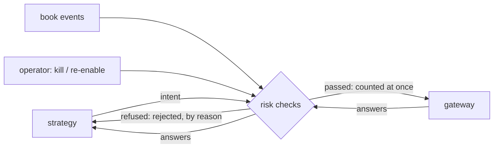

# 003 — Pre-trade risk

**Status:** Measured · **Updated:** 2026-10-31

## Proposal

Component 4 of note 001: every intent of the strategy (note 002) passes the risk checks or is
refused before it reaches the gateway, and the risk state follows every order from the moment it
is sent to its last answer. The checks are note 001's D3, taken from the public rules' text.

It does:

- the checks of RTS 6 Article 15 on order entry, its execution throttle, an instrument permission
  list, and SEC Rule 15c3-5's credit threshold on exposure from open orders and fills, each order
  counted as it is sent (Art. 15(2));
- refusals by reason, counted; a refused intent answered to the strategy as `rejected`, at once;
- the kill switch (RTS 6 Art. 12): no new order or replace passes, and every open order is
  cancelled; engaged by the operator or by the execution throttle, re-enabled only by the operator;
- a reference implementation, written for clarity, the oracle and the baseline;
- limits from a configuration file.

It does not:

- override a refusal (Art. 15(6)'s procedure for submitting a blocked order: D6);
- monitor in real time for disorderly trading (Art. 16), or give the operator a way in: note 004
  (the program, its monitoring block and the kill command);
- keep positions across days, margin, or check after the trade (note 001);
- check what the gateway already checks for the session (ClOrdID uniqueness, the order state
  machine): the gateway's own refusals come back as `rejected` and release what they held.

## Design

**What the rules ask, and the check for each** (text from legislation.gov.uk's copy of RTS 6,
up to date to 30 October 2026, revocation under FSMA 2023 not yet applied; 15c3-5 from Cornell
LII's copy of 17 CFR 240.15c3-5):

| Rule | Its words, in short | The check |
|---|---|---|
| Art. 15(1)(a) | price collars, order by order and over a specified period | **collar**: a buy's price within a band of the instrument's best ask, and within a band of a reference price fixed at the start of each period (D2) |
| Art. 15(1)(b); 15c3-5 (c)(1)(ii) | maximum order value; erroneous orders by price or size | **order value**: price x quantity at most a limit |
| Art. 15(1)(c); 15c3-5 (c)(1)(ii) | maximum order volume | **order volume**: quantity at most a limit |
| Art. 15(1)(d) | maximum messages: submission, modification or cancellation | **messages**: news, replaces and cancels counted in a sliding window; news and replaces refused at the limit, cancels counted and never refused |
| 15c3-5 (c)(1)(ii) | duplicative orders | **duplicate**: a new order for an instrument that already has an order open or in flight |
| Art. 15(2) | all orders sent included in the limits immediately | every passed request counted at once, before any answer (D3) |
| Art. 15(3) | after a set number of repeated executions, disabled until re-enabled by a designated person | **execution throttle**: fills counted in a sliding window; at the limit the kill switch engages (D4) |
| Art. 15(4), (5); 15c3-5 (c)(1)(i) | market and credit limits; block orders compromising risk thresholds, by instrument and firm | **exposure**: per instrument, open buy value plus position value at most a limit; for the firm, the sum at most a limit (D5) |
| Art. 15(5); 15c3-5 (c)(2)(ii) | orders in an instrument the trader may not trade | **permission**: the instrument on the configured list |
| note 001, D3 | no order on a book that cannot be trusted | **book usable**: the instrument's last book event usable (note 002's rule) |
| note 001, S2 | none while the gateway is not logged on | **session**: the gateway logged on (an input the program sets, note 004) |
| Art. 12 | cancel any or all unexecuted orders at once | **kill switch** |

Checks run in a fixed order (kill, session, permission, book usable, duplicate, volume, value,
collar, messages, exposure), and a refusal names the first that failed. Cancels pass every
check: they only lower exposure, and a kill must be able to send them.

**The risk state.** Per instrument: the order open (its price and quantity), the request in
flight, the position (shares bought and filled, and their cost), the last book event. For the
firm: the exposure summed, the message window, the fill window, the kill switch. Answers move
it: accepted (nothing changes: it was counted at send), replaced (the new price and quantity
replace the old), cancelled or rejected (released), filled and partly filled (open value to
position, at the fill's price; note 004 gives the fill's price and quantity with the answer, so
`order_answer` gains them).

**Prices and values.** ITCH prices (four implied decimals) and shares, values in 1e-4 dollars
in 64 bits (a $100,000 order is 10^9: room to spare); bands in basis points.

**Time.** The windows (messages, fills, the collar's periods) run on the ITCH timestamp of the
last book event seen (D1), so a recorded day replayed gives the same verdicts (note 001, S3).

**The reference implementation**: the same checks over standard containers, recomputing exposure
from every order and fill kept (no running sums), so a sum kept wrong in the fast one shows.

**Decisions** (each with what is proposed):

- **D1. The windows' clock.** *Proposed (A):* the ITCH timestamp of the last book event (market
  time): deterministic on replay; at the day's own pace it is real time. *Alternative (B):*
  `CLOCK_MONOTONIC`: real time always, but a replay at another pace gives other verdicts and
  note 001's S3 holds only with the limits loose.
- **D2. The collar over a period.** *Proposed (A):* each instrument's reference price is its best
  bid at the first usable event of each period (default one minute); an order's price more than
  the band (default 10%) from it is refused, so a market moving fast is followed only a band a
  minute. *Alternative (B):* order by order only (the best ask band), the period left to the
  venue's own limit-up limit-down: weaker than Art. 15(1)(a)'s "over a specified period".
- **D3. A replace in flight.** *Proposed (A):* counted at both prices until answered (the old
  order can still fill while the new is being placed): the worst case, as Art. 15(2) asks.
  *Alternative (B):* the larger of the two: less refused, but a fill of the old order during a
  replace that then succeeds is not covered.
- **D4. The execution throttle.** *Proposed (A):* fills (whole or part) counted in a sliding
  window (default 1,000 a minute); at the limit the kill switch engages, re-enabled only by the
  operator. Art. 15(3)'s "number of times an algorithmic trading strategy has been applied" read
  as executions, its own next words. *Alternative (B):* intents counted instead: that is the
  messages limit again.
- **D5. Market and credit limits.** *Proposed (A):* per instrument, open buy value plus position
  value (shares held at cost) at most a limit; for the firm the sum at most a limit: the
  strategy only buys, so exposure only grows with fills, and the day shows the limit stopping
  new orders. *Alternative (B):* the firm's limit only: Art. 15(5) asks for instrument-level
  controls "where appropriate".
- **D6. Overrides (Art. 15(6)).** *Proposed (A):* none: every refusal is final, stated as out of
  scope (an override is a procedure with a designated person, not code). *Alternative (B):* a
  one-shot override command for a named request: code for a procedure the repo cannot show.
- **D7. The gateway's own throttle.** *Proposed (A):* off: the messages limit here is the one
  limit, refusing with a reason the strategy is told at once; the gateway's would refuse later
  with a retry time. *Alternative (B):* both on, the gateway's looser, as a second line.

## Spec

- S1. Each check refuses the intents built to break it, by the reason named, counted; each
  refused intent is answered `rejected` to the strategy and reaches no gateway; cancels pass
  every check, the kill switch's included.
- S2. Counting at send: from the moment a request passes, the exposure, message and duplicate
  checks count it, before any answer; rejection or cancellation releases it, a fill moves it to
  position; a replace in flight counts both prices (D3). Tested by sequences of intents and answers.
- S3. The kill switch: once engaged (by the operator or by D4's throttle) no new order or replace
  passes, a cancel goes for every open order and request in flight, and only the operator
  re-enables it.
- S4. Over the sample day (D5's 100 instruments, note 002's model venue, limits set so that every
  check refuses some), the fast checks and the reference implementation give the same verdict
  for every intent and the same exposure after every answer; and a random run of intents and
  answers likewise.
- S5. Over the same day, every intent passed is checked again after the run against the limits
  as they stood when it was sent, from the log alone: every order the venue receives passed
  every check (note 001's S1).
- S6. Checking an intent and taking an answer allocate nothing and make no system call (the
  compiled call graph checked).
- S7. The cost of a check, and of the risk thread's work over the day, measured beside the
  reference implementation and published via `run.py report`.

## Tasks

- [x] The limits and their configuration file (`include/ttt/limits.hpp`, `config/limits.conf`); `order_answer` with a fill's price and quantity
- [x] The checks and the risk state (D1–D5, D7), the kill switch: `include/ttt/risk.hpp`
- [x] The reference implementation: `include/ttt/reference_risk.hpp`
- [x] Tests S1–S6: `risk_test`, `risk_day_test` (label `data`), `check_hot_path`
- [x] The benchmark (S7): `bench/risk_bench.cpp`, `run.py`'s risk set

## Review

| Date | Stage | Finding |
|---|---|---|
| 2026-10-31 | Draft | Written for review. Checked: RTS 6 Articles 12, 15 and 16 on legislation.gov.uk (up to date to 30 October 2026; revocation by FSMA 2023 listed, not yet applied; EUR-Lex gave no text to compare); 17 CFR 240.15c3-5 (c) on Cornell LII (eCFR redirected). Art. 15(3) is not a rate limit: it disables the system after a number of executions until a designated person re-enables it (D4). 15c3-5 (c)(1)(ii) also asks for duplicative orders to be refused (the duplicate check). The gateway's order book already throttles messages if configured (its note 007, D4): D7 |
| 2026-10-31 | Agreed | Approved by Shep, every decision as proposed (option A each): D1 market time for the windows; D2 a reference price a period (one minute, 10% band); D3 a replace in flight counted at both prices; D4 fills in a sliding window engage the kill switch; D5 instrument and firm exposure limits; D6 no override; D7 the gateway's throttle off |
| 2026-10-31 | Built | Read precisely while building: the risk is the strategy's output; a refusal is queued and taken by the loop (`take_refusal`), so the strategy is never called back inside its own call. The risk's own cancels (kill) carry `kill_bit` in their ID; their answer reaches the strategy as the venue cancelling the order, under the order's ID, and their rejection does not reach it (the order filled meanwhile, or replaced: then cancelled again). A cancel of the strategy's is kept apart from its new or replace in flight. A replace answered for an order already gone by the risk's account is counted at the replace's whole quantity (the venue says it lives). The limits are inclusive (exactly the limit passes). Note 004 maps the gateway's order events to `order_answer` (a fill's price and shares with it), gives the risk the session's state, and the operator the kill and re-enable |
| 2026-10-31 | Built | Found by the random run against the reference (S4): a cancel sent while a request was in flight overwrote it, leaving the request's value in the running firm sum; and a replace answered for an order already gone made an order with no shares in the fast checks but none in the reference. Both fixed in both; a mutant (cancels not counted as messages) caught by S1 and S4. The reference's windows scanned every time kept at each check (quadratic over a day): they now count back from the newest |
| 2026-10-31 | Built | Tests: `risk_test` (the configuration file; S1 each check by an intent built to break it, the edges inclusive, cancels through every check; S2 counting at send, a replace in flight at both prices; S3 the kill by the operator and by D4's throttle, an order acknowledged or replaced after it cancelled then; S4 in small, 300,000 random steps reaching every refusal reason); `risk_day_test` over the sample day (111 s): D5's 100 instruments, note 002's model venue, limits set to reach what the strategy can (value $30,000, ten instruments not permitted, period collar 30 bps, 40 messages a second, 40 fills a minute, $100,000 an instrument, $5 million the firm; the session down 09:30:10–09:30:40; the operator's kill 09:45–09:50, the throttle's re-enabled five minutes on). S4: the checks and the reference agree on every send, refusal, answer and count after every message, exposures every 100,000 messages: 17,698 passed, 671 cancels, 1,290 fills, 28 kill cancels, kill engaged twice; refused by kill 117,937, session 19,523, permission 171,031, value 782,428, period collar 221,023, messages 2,126, instrument exposure 3,645,986, firm exposure 990,539; the firm's exposure never past its limit. The strategy cannot reach unusable, duplicate, volume or collar (it never sends on an unusable book, keeps one order an instrument, a round lot, at the bid): `risk_test` covers them. S5: from the log alone a fresh reference replayed 5,968,962 intents to the same verdicts, and the venue received exactly what passed. S6: five risk subjects, memory functions only. ASan/UBSan and TSan clean. Trial of S7 (not bench mode): an intent's check p50 28 ns against 20 with no checks (the timer pair's own cost and a push), the reference 1,711; most of the strategy's intents refused by firm exposure once the model venue's fills are held (D5), the last check, so the full path |
| 2026-10-31 | Built | Runs published (S7): three at ceddf71 (`results/risk-dev-lnx01-20261031T174456Z.json`, `180106Z`, `185434Z`), every one bench mode, built clean, the checks and the reference sending the same intents. p50 against no checks: an intent's check 25 ns against 21 (+4), a book event's handling 34 against 23 (+11: the checks' own work on the event, the reference prices and the period), an answer's 32 against 22 (+10); p99 of a check 40–41 against 29; the reference's check 1,789–1,829 ns. Throughput 10.85–10.88M book events/s against 12.26–12.27M. Spread between runs within 1 ns at p50 for the fast cases. Against S7: measured over the day's first 50,000,000 messages (4,717,340 book events, the open among them), not the whole day; the S4 and S5 day test covers the whole day for correctness. Refused 1,049,227 of 1,109,961 intents, 1,006,029 by firm exposure (the last check, so each runs the full path): the default limits are not tuned to the strategy, and the published figure is the cost of checks mostly ending in a refusal |
| 2026-10-31 | Measured | Approved by Shep (option A): S1–S6 met; S7 met as qualified (the day's first 50,000,000 messages, the open among them; the cost of a check does not depend on the run's length, and the whole day is covered for correctness by S4 and S5). No open items raised by this note |
