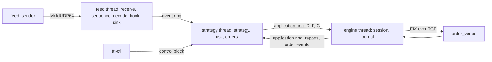

# 004 — The program

**Status:** Agreed · **Updated:** 2026-10-31

## Proposal

Components 1, 5 and 7 of note 001 joined into one program, `ttt`: the feed handler's feed and
books, the strategy's sink (note 002), the strategy and the risk checks (notes 002, 003), and the
gateway's engine, its session and journal, connected to the venue. It runs the sample day from
our sender to `order_venue` in each of note 001's three arrangements (D4), gates orders on the
feed's reliability and the gateway's session, takes the operator's kill and re-enable, and
reports itself in a monitoring block. Note 005 measures it.

It does:

- the three arrangements from one configuration file: A (feed thread, ring, strategy and risk
  thread, engine thread), B (feed, strategy and risk on one thread), C (a consumer process of the
  program `itchfh`'s publisher, through note 002's adapter);
- intents to the gateway as FIX order messages (D1), the gateway's answers back as
  `order_answer` (D2), the session's state to the risk (D3);
- recovery of a lost feed from a snapshot, as `itchfh` does (the feed handler's note 011), with
  the strategy's sink in place of the publisher (open item T2, D4);
- the operator's commands, kill, re-enable and stop (D5), and the end of the day (D8);
- a monitoring block and a tool to read it.

It does not:

- measure (note 005: the venue's stamp, tick to trade and its stages, D6's durability and D7's
  paces of note 001);
- restart mid-day with orders open (D6);
- change the feed handler or the gateway beyond D3 and D4's two changes. The gateway is fetched
  here for the first time, at a pinned commit, its `lockfree-ipc` pin checked as the feed
  handler's is (both `c733131` today).

## Design

**The threads** (arrangement A, the default):

- *Feed thread:* the feed handler's `feed_one` and recovery (its notes 007, 011) on the default
  book, with note 002's sink pushing into the event ring; on a loss, the standby book is rebuilt
  on a housekeeping CPU as in `itchfh`. It also writes the feed handler's own monitoring block,
  so `itchfh-monitor` works unchanged.
- *Strategy thread:* each pass pops book events (risk, then strategy, then refusals taken, as
  `risk_bench` does), drains the gateway's ring into answers (D2), reads the session's state
  (D3) and the control block (D5); every request the risk passes is written as an order message
  into the gateway's application ring (D1). Busy-polls.
- *Engine thread:* the gateway's direct engine, busy-polling, journal C, as the gateway publishes
  its fastest; the pipeline (journal A beside, note 001's D6) a configuration key.

B runs the strategy's work inside the sink's push, on the feed thread: no event ring. C is a
second process reading `itchfh`'s publisher (the feed handler's note 008) through note 002's
adapter, its strategy thread as in A. C must attach before the day's Stock Directory messages
(open item T1, a limit): the program is started before the sender.

**Orders out.** The engine takes an order as its MsgType and body (the gateway's note 005, D5).
The strategy thread writes them from three fixed templates (D, F, G), the variable fields
written in place: ClOrdID (the intent's 64-bit ID in decimal; the risk's own cancels carry
`kill_bit`, note 003), OrigClOrdID, Symbol, Side buy, OrderQty, OrdType limit, Price, TimeInForce
day, TransactTime. TransactTime is from the TSC, converted to UTC with the offset taken at start,
so the hot path makes no system call (S4 of note 001).

**Answers in.** For each ExecutionReport and OrderCancelReject the gateway delivers the message
as received and then the order's state after it (its note 007). D2 maps them:

| From the gateway | `order_answer` |
|---|---|
| ExecutionReport ExecType New (0) | accepted, the report's ClOrdID |
| ExecType Replaced (5) | replaced, the report's ClOrdID |
| ExecType Canceled (4) | cancelled, the report's ClOrdID: the cancel's when it answers one, the order's when it is the venue's own |
| ExecType Rejected (8) | rejected, the report's ClOrdID |
| ExecType Trade (F) | filled if LeavesQty is 0, else partly filled; LastQty and LastPx (32, 31) with it |
| OrderCancelReject (9) | rejected, its ClOrdID (the request's) |
| refused by the gateway, or not sent (its note 007, D4, D5) | rejected, the request's ClOrdID |

**The gateway's capacities.** Its order tables keep every ClOrdID and ExecID for the session's
life (its note 007, D3), sized by default for 65,536 orders and 1,000,000 ExecIDs; full refuses
new orders until the next reset. The strategy makes 5.27 million intents over the day on 100
instruments (note 002), so the program sizes them from its configuration for the day, and the
memory this costs is stated with the figures.

**Configuration**: one file, `key = value` checked as the feed handler's (its note 009, D7): the
arrangement; the CPUs (feed, strategy, engine, standby rebuild); the feed handler's own keys
(group, ports, snapshot service, books); the session (CompIDs, venue address and port, journal
kind and path, engine); the instrument list (note 002's `config/open-*.txt`) and the limits
(`config/limits.conf`); the gateway's capacities; the control and monitoring block names.

**Monitoring**: a seqlocked block in shared memory (as the feed handler's note 009), written by
the strategy thread every 100 ms: the arrangement; the session's state; the kill switch; the
strategy's counts; the risk's counts and refusals by reason, exposures; the event ring's set
aside and replaced; the answers mapped and unknown; the gateway's refusals. `ttt-monitor` prints
it.

**Decisions** (each with what is proposed):

- **D1. Orders to the gateway.** *Proposed (A):* FIX bodies written by the strategy thread from
  fixed templates, the gateway unchanged. *Alternative (B):* a binary order in the ring, encoded
  by the gateway: less on the strategy thread, but a change to the gateway's interface and its
  encoder.
- **D2. Answers from the gateway.** *Proposed (A):* mapped from the message as received (the
  fields of the table above) and the order event after it, the gateway unchanged. *Alternative
  (B):* the gateway's order event extended with the request's ClOrdID and the fill's quantity and
  price: no field reading here, but a change to the gateway's interface.
- **D3. The session's state.** The direct engine's `connected()` is the TCP connection, not the
  session logged on; the pipeline's is logged on. *Proposed (A):* a change to the gateway: both
  engines publish `logged_on()` (the session active: Logon answered and caught up), read by the
  strategy thread each pass into the risk's session input. *Alternative (B):* the connection
  taken as logged on: an order between connecting and the Logon's answer would pass the risk and
  be held by the gateway (its note 003, D2), which note 001's S2 forbids.
- **D4. Open item T2's form.** *Proposed (A):* a change to the feed handler: `published_on` and
  `recovery` take the sink as a template parameter, the publisher its default, so `itchfh` and
  its tests are unchanged; this repo's sink already has the calls. *Alternative (B):* the recovery
  copied into this repo for the sink: no change there, but two copies of note 011's code.
- **D5. The operator's commands.** *Proposed (A):* a control block in shared memory, written by
  `ttt-ctl kill | reenable | stop`, read by the strategy thread each pass; each command numbered,
  taken once and acknowledged in the monitoring block. *Alternative (B):* signals (SIGUSR1 kill,
  SIGUSR2 re-enable): no tool, but a signal is delivered to any thread that does not block it,
  so every busy thread must block them or be stopped by the delivery.
- **D6. Starting and restarting.** *Proposed (A):* each run is a new session (sequence numbers
  from 1, a fresh journal); the program refuses to start over an existing journal. A restart
  with orders open is out of scope, stated as a limit. *Alternative (B):* on restart, the risk and
  the strategy rebuilt from the order states the gateway replays from its journal (its note 007,
  D6): what a real deployment needs, and a component of its own.
- **D7. Note 001's S3** ("the sample day replayed twice gives the same orders") cannot hold for
  the program: the strategy keeps one request in flight an instrument, so when the venue's answer
  arrives, relative to the book events, decides what it sends next, and that varies run to run.
  *Proposed (A):* amend S3: the strategy and the risk give the same orders for the same inputs
  in the same order (already shown by notes 002 and 003's day tests); two runs of the program are
  compared and their agreement published (orders equal, the first difference), not required.
  *Alternative (B):* also record every input the strategy thread takes (events, answers, the
  session's state, commands), in order, to a writer thread, and replay the recording offline to
  the same orders: proves the program's thread is the tested one, at a copy an input and a
  thread.
- **D8. The end of the day.** At the feed's end, or on `stop`: *Proposed (A):* the kill switch
  engaged (every open order cancelled), the answers awaited (up to 5 s), then the gateway's
  logout, and the program exits with its counts. *Alternative (B):* the logout alone, the venue's
  cancel-on-disconnect left to remove the orders: true of `order_venue`, not of every venue.

## Spec

- S1. In the program, every D, F and G the gateway sent (read back from its journal after the
  run) is a request the risk passed, in the same order; the program keeps the IDs passed in a
  list allocated at start, written at exit.
- S2. In the program: with the venue stopped, no order or replace is sent until the session is
  logged on again; after `ttt-ctl kill`, no order or replace is sent and the venue holds no order
  of ours once the cancels are answered; after `reenable`, orders resume. A feed loss is
  recovered from a snapshot with the sink in place (T2), and no order is sent for an instrument
  while its book is unusable.
- S3. As amended by D7.
- S4. The strategy thread's pass (an event, an answer, an order written) allocates nothing and
  makes no system call (the compiled call graph checked, as notes 002 and 003).
- S5. The answer mapping (D2) for every row of its table, against the gateway's venue simulator.
- S6. The day through the programs (`feed_sender`, `ttt`, `order_venue`) in each arrangement,
  over loopback: runs to the end, S1 holds, the counts reported; D8's ending leaves no order at
  the venue.

## Tasks

- [x] The feed handler: the recovery takes its sink as a parameter (D4); re-pinned here
- [x] The gateway: `logged_on()` on both engines (D3); fetched here at a pinned commit
- [x] Orders out (D1) and answers in (D2): `include/ttt/orders.hpp`; S5's test
- [ ] The program `ttt`: configuration, arrangements A, B and C, the gateway's capacities, D6, D8
- [ ] Control and monitoring: the blocks, `ttt-ctl`, `ttt-monitor` (D5)
- [ ] `feed_sender` and `order_venue` built here from their pinned sources (into `build/`)
- [ ] Tests S1, S2, S4, S6 (the day: label `data`); note 001's S3 amended (D7)

## Review

| Date | Stage | Finding |
|---|---|---|
| 2026-10-31 | Draft | Written for review. Read while writing: the gateway's engine, pipeline, order book and `order_venue` (fix-order-gateway at e737703); the feed handler's `itchfh` and recovery (its note 011). Found: the direct engine publishes the connection, not the session (D3); the gateway's order tables never free an entry and are sized below a day (capacities); note 001's S3 cannot hold against a live venue (D7) |
| 2026-10-31 | Agreed | Approved by Shep, every decision as proposed (option A each): D1 FIX bodies from templates; D2 answers from the message and the order event; D3 `logged_on()` in the gateway; D4 the feed handler's recovery takes its sink as a parameter; D5 a control block and `ttt-ctl`; D6 a new session each run; D7 note 001's S3 amended; D8 kill, answers awaited, logout |
| 2026-10-31 | Agreed (building) | Corrected while building: a cancel's report is read by its own ClOrdID (the cancel's), not OrigClOrdID: the strategy settles a cancel by the request's ID and takes the order's ID as the venue's own cancel (note 002). Read precisely: an ExecutionReport carries LeavesQty, LastQty and LastPx itself, so each report and OrderCancelReject is read from the message alone and the order event after it is passed over; only a refused or not-sent event is read (D2 otherwise as agreed). The gateway's session needs its generated FIX 4.4 dictionary: generated here with its script, from the orchestrations at the commit and hashes it pins (checked against its CMakeLists). Upstream: itch-feed-handler d41cae3 (D4), fix-order-gateway 2bc4e40 (D3), both pinned. `orders_test` (S5): every row of D2's table, through the direct engine over loopback to the venue simulator, the rest from built slots; TransactTime's form; ASan/UBSan and TSan clean |
