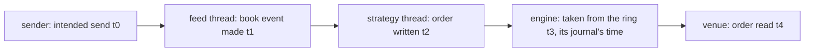

# 005 — Measurement

**Status:** Agreed · **Updated:** 2026-10-31

## Proposal

Components 6 and 8 of note 001: tick to trade, measured as the repos before it measure, open
loop, percentiles over at least three runs, the machine's conditions in every run. From the time
our sender meant to send the ITCH message that caused an order to the time the venue reads that
order, split into stages, for note 001's paths, paces, arrangements (D4) and durabilities (D6),
beside the components' own published figures.

It does:

- the venue's stamp (note 001's D5: `order_venue` unchanged but for it), the program's two stage
  stamps, and a benchmark that runs the programs and joins what they record;
- the figures by path, pace, arrangement and durability, and the stages of the headline (D7);
- open item T3 (kernel drops at 50k packets a second): explained, or stated with every figure it
  touches, before any 50k figure is published (D5);
- note 001's S3 as amended: two runs' agreement published.

It does not:

- change what the program does: the stamps are off unless configured, and their cost is stated;
- measure throughput over the day: the feed handler's note 010 does, and the program adds the
  strategy's work, published in notes 002 and 003.

## Design

**What a clock can see** (note 001): the sender writes each message's intended send time into a
shared-memory array by sequence number (the feed handler's note 010, D1); the venue reads each
order and stamps it, on the same machine and the same `CLOCK_MONOTONIC` (a network namespace
shares it). The array holds 4 million messages and is overwritten after that (a few seconds at
50k packets a second), so the program reads the stamp when it sends the order, not after the run.

**The stages:** t0 to t1, the feed (the sender's kernel, loopback or the card, the receive,
sequencing, decoding, the book and the sink); t1 to t2, the hand-off and the strategy and risk
checks; t2 to t3, the application ring to the engine; t3 to t4, the session, the journal, the
encode, TCP and the venue's read. t1 is a field the book event gains (it has 14 bytes spare; the
stamp is left out of the event's equality, so the day tests' comparisons are unchanged); t2 is
written beside each order the risk passes, with the order's ClOrdID, its message's sequence and
t0 read from the array, in a list allocated at start and written at exit; t3 is the time of the
order's send record in the gateway's journal (no change there); t4 is the venue's.

**The venue's stamp:** `order_venue` gains an optional argument: for each D and G it reads, its
ClOrdID and the time the read that held it returned (the time its turnaround already starts
from), in a list written when the connection ends. A change to the gateway (note 001's D5).

**The benchmark** (`t2t_bench`, run by `bench-run` in bench mode, the harness's checks in its own
process): for each point it starts `order_venue`, `ttt` (and `itchfh` for arrangement C), drives
our sender over its control port as the feed handler's `e2e_bench` does, waits for the program's
end (D8 of note 004), then joins the program's list, the gateway's journal and the venue's list
by ClOrdID into one run file with the environment block. Over the card, Shep starts the sender
and the venue in the card's far namespace first (the feed handler's `tools/card-link`, namespace
`itchfh-peer`), as for the feed handler's runs, and the benchmark drives them at 10.99.0.2.

**Decisions** (each with what is proposed):

- **D1. What is timed.** The strategy keeps one request in flight an instrument (note 002), so an
  order is caused either by a book event (the bid moved and nothing was in flight) or by an
  answer (the request in flight came back and the bid had moved meanwhile). *Proposed (A):* tick
  to trade is t0 to t4 for each D and G caused by a book event; those caused by an answer have no
  tick and are counted apart, their share published (and cancels, F, are not timed). *Alternative
  (B):* also time answer-caused orders from the answer's arrival: another figure (answer to
  order), not tick to trade.
- **D2. The program's stage clock.** *Proposed (A):* `clock_gettime(CLOCK_MONOTONIC)` (the vDSO,
  no system call with the TSC clocksource), the sender's and the venue's clock: two reads an
  order, their cost measured and stated (S4 of note 004 then allows the vDSO call when stamping
  is configured). *Alternative (B):* the TSC, converted at start: cheaper, but the conversion
  drifts by up to the calibration's spread (10 ppm: 3 ms over five minutes), larger than the
  figure.
- **D3. Which points.** *Proposed (A):* the headline, arrangement A with journal C, on loopback
  and the card, at 10k, 25k and 50k packets a second over the first 50 million messages and at
  the day's own pace over the open (09:29:30 for five minutes, the feed handler's note 010, D3);
  beside it, at 25k and over the open, loopback only: B, C, and journal A. About 25 minutes a
  run on loopback, 10 on the card; three runs each. *Alternative (B):* the alternatives on the
  card too: about 60% more bench time; the card adds the same path to each.
- **D4. Journal A's engine.** *Proposed (A):* the gateway's pipeline (its fastest with A: p50 140 µs
  against the direct loop's 255 at 10k orders a second, its note 008) with journal A on ext4 over the battery-backed controller, as it publishes.
  *Alternative (B):* the direct loop with A: what the program's default engine would cost with
  A, but 10k orders a second sustained at most (the gateway's note 008).
- **D5. Open item T3.** *Proposed (A):* every point counts its kernel drops; the first bench-mode
  runs decide: if there are none there, T3 is closed as found outside bench mode only; if there
  are, the points are published with their count and the re-requested messages' latency left in
  (open loop: they are the tail), stated with the figure, and the cause looked for. *Alternative
  (B):* points with drops withheld.
- **D6. The report.** *Proposed (A):* one table of tick to trade (p50, p99, p99.9, max) by path,
  pace, arrangement and journal, with orders timed, the answer-caused share, kernel drops and the
  sender's lateness; one of the headline's stages (p50, p99); the components' own figures beside
  (the feed handler's packet to published update, the gateway's order to ExecutionReport); note
  001's S3 agreement; a README summary: the headline at 25k on both paths and over the open.
  *Alternative (B):* the stages for every point.

## Spec

- S1. Tick to trade (D1), open loop, published as p50, p99, p99.9 and max for each point of D3,
  as ranges over at least three runs, with the orders timed, the answer-caused share, kernel drops
  and the sender's lateness; in every run S1 of note 004 holds and every timed order is joined
  (sender, program, journal, venue), none missing.
- S2. The headline's stages (t0 to t1, t1 to t2, t2 to t4: amended, three, the journal's time being the engine's pass's)
  published, each in order (t0 ≤ t1 ≤ t2 ≤ t4) for every order.
- S3. The measurement's own cost (the clock reads, the stamp read, the lists) measured and stated;
  with stamping off the program is unchanged (S4 of note 004 as it stands).
- S4. T3 decided per D5 before any 50k figure is published.
- S5. Every run carries the harness's environment block, and a run outside bench mode or from
  an unclean build is refused for publication.
- S6. Note 001's S5 and S6: the components' figures beside, and the default (A, journal C)
  justified from the alternatives.

## Tasks

- [x] The gateway: `order_venue`'s stamp list; re-pinned here
- [x] The program: t1 in the book event, t2 and the list (configured `stamps`), the stamp read
- [x] `t2t_bench`: the points, the join, the run file; the measurement's cost
- [x] `run.py`: the t2t set and its tables, the README block
- [ ] Shep: three runs a path; publish; review

## Review

| Date | Stage | Finding |
|---|---|---|
| 2026-10-31 | Draft | Written for review. Read while writing: the feed handler's note 010 (stamps, open loop, the open's window) and `stamps.hpp` (4 million entries, so read live); its `tools/card-link` (multicast over the card, namespace `itchfh-peer`); `order_venue`'s turnaround stamp. Found: orders caused by an answer have no tick (D1); the program's clock must be `CLOCK_MONOTONIC`, not a converted TSC (D2) |
| 2026-10-31 | Agreed | Approved by Shep, every decision as proposed (option A each): D1 D and G caused by a book event timed, answer-caused counted apart; D2 `CLOCK_MONOTONIC` stage stamps; D3 the headline on both paths at three paces and the open, the alternatives at 25k and the open on loopback; D4 journal A on the pipeline; D5 T3 decided by the first bench-mode runs; D6 the report |
| 2026-10-31 | Agreed (building) | Built so far: `order_venue`'s stamps (fix-order-gateway aa4d2e0, CI green, pinned); t1 in the book event (stamped by the sink, or the adapter in C, when `stamps` is configured; left out of equality), the trader's trace (t0 read from the sender's array at send, t1, t2; answer-caused orders sequence 0), `stamps`/`trace` keys; S4's check allows `clock_gettime` (the vDSO); `t2t_bench` and `run.py`'s t2t set (dry-run on a trial). Found: (1) the journal's send record carries the engine's pass time, which can start before the order reaches the ring (trial: t2 to t3 p50 -855 ns), so it cannot split t2 to t4: the stages are three (feed, strategy and risk, gateway and venue); the journal still checks each timed order was sent. (2) The open cannot be run as D3 says: the sender's own-pace mode starts at 09:29:30 (message 13,406,693), and the program then has no Stock Directory, so no instruments and no orders; joining from a snapshot is not open to C (the publisher is muted while a snapshot is applied, so the adapter never learns the locates: T1). For Shep. Trial (loopback, 10k, 5 million messages, not bench mode): 111,778 orders timed, 21% of orders caused by an answer, tick to trade p50 27.9 µs (feed 9.1, strategy and risk 0.4, gateway and venue 19.9); a clock read 38 ns, a stamp read 42 ns, the timer pair alone 18 |
| 2026-10-31 | Agreed (amended) | Decided by Shep (option A each): the open after the morning, the sender sending messages 1 to 13,406,692 at 50,000 packets a second, then the open at the day's own pace, only orders caused by the open's messages timed (itch-feed-handler 36d7a92: `feed_sender`'s R with both a pace and a speed; CI green; pinned); three stages (S2 amended). `t2t_bench --quick` is a check run: each point at 25k over 5 million messages. Trial (loopback, not bench mode): the open, 154,498 orders timed, 0 unjoined, p50 22.7 µs (feed 11.2, strategy and risk 0.5, gateway and venue 8.1 against 19.1 at 10k: to be seen in bench mode), max 47.5 ms with the sender up to 8.6 ms late |
| 2026-11-01 | Agreed (building) | Bench mode, 7bfe774: a check run (`--quick`) clean (25k p50 A 28.0 µs, B 28.1, C 30.0, journal A 102.4; 0 kernel drops), then two of three loopback runs (20261031T231432Z, 234429Z; the third not run: sudo's password expired mid-loop). Both complete, every order joined, none out of order, 0 kernel drops at every point, 50k included; gateway and venue p50 8.0, 11.8, 17.7 µs at 10k, 25k, 50k. **Withheld:** every point's max was ~90 ms (~45 ms over the open). Found with a trial keeping its files: all of it between the journal and the venue, one engine pass holding every order for 44 ms (~370k messages) and 89 ms (~750k): `journaled_session` built the gateway's store of sent messages with its 64 MB default, and past it the vector reallocated and copied itself. Decided by Shep (A): the reserve configured in the gateway (fix-order-gateway 4c1a05b, its note 004 amended, CI green; none of its own published sets reaches 64 MB), `ttt`'s `store_mb` (2048) and `store_messages` (16 million) for the day, re-pinned. Trial at the pin (10k, 50 million messages, not bench mode): max 6.5 ms, the sender's lateness (was 94.6 ms). The loopback runs to be made again |
